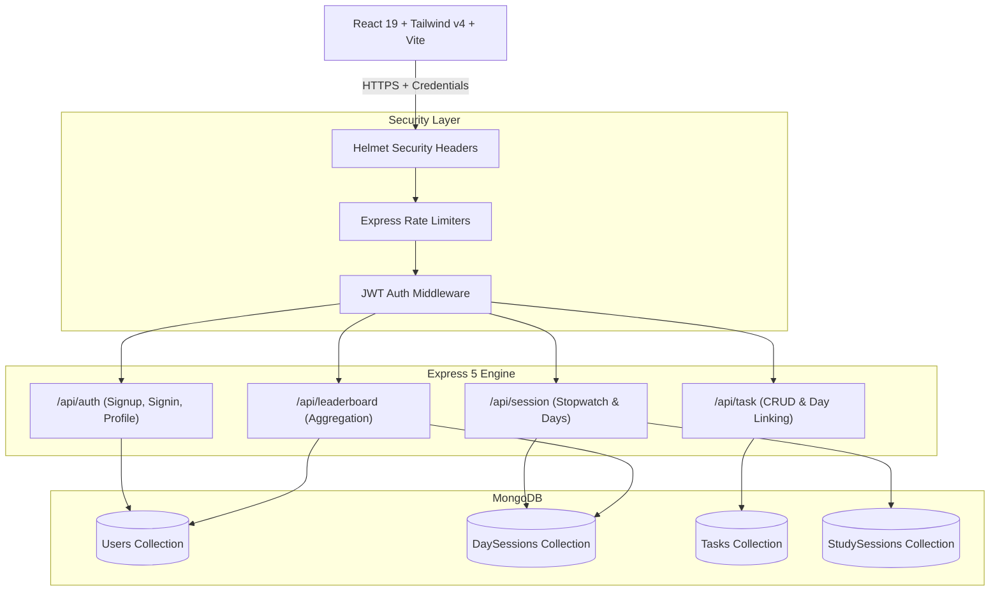

# ⚡ Parkin-son — The Ultimate Deep Work & Focus Workspace

> **Lock in, build streaks, and conquer your deep work sessions.**  
> Parkin-son is a modern, high-performance focus workspace built for developers, students, and makers. Designed with sleek dark aesthetics, real-time session tracking, and a community focus arena.

---

## 🌟 Features

### 1. 🔐 Dual-Layer Authentication Engine
- Secure token-based authentication using **JWT** and **HttpOnly cookies**.
- Dual fallback supporting both `Cookie` and `Authorization: Bearer <token>` in `localStorage`.
- Passwords salted and hashed with **Bcrypt** (10 salt rounds).
- Protected client-side routing with automatic session restoration and instant bounce-back.

### 2. 🗂️ Daily Focus Workspace & Task Management
- **Day Focus Boxes**: Organize tasks daily with strict timezone normalization to prevent date drift.
- **Optimistic Task CRUD**: Instant task creation, completion toggling, and deletion with zero UI latency.
- **Dynamic Progress Engine**: Live visual progress indicators tracking daily goal completion rates.

### 3. ⏱️ Interactive Focus Stopwatch & Session Logger
- High-precision interval timer with smooth digit transitions (`HH:MM:SS`).
- **Smart Chunking Engine**: Automatically accumulates pause durations without database bloat.
- **Auto Session Logger**: Final saves increment user daily focus time (`totalDaytime`), stopwatch time, and total completed sessions.
- Real-time status cards: *Today's Focus*, *Sessions Logged*, and *Status*.

### 4. 🏆 Focus Arena (Community Leaderboard)
- **Top 3 Podium**: Visual recognition for Top 3 performers (#1 Gold Champion with Crown, #2 Silver, #3 Bronze).
- **MongoDB Aggregation Pipeline**: High-speed server-side aggregation grouping sessions by user and ranking by focus XP.
- **Dual-View Standings**: Toggle between *All-Time Focus Standings* and *Today's Leaderboard*.
- Live indicators showing user streaks, avatar identifiers, and focus metrics.

### 5. 🛡️ Production-Grade Security Hardening
- **Helmet**: Configured HTTP security headers protecting against XSS, clickjacking, and MIME sniffing.
- **Express Rate Limiting**: Anti-brute-force limiter for `/api/auth/` and general API DDoS mitigation.
- **CORS Credentials**: Strict origin whitelisting allowing secure cross-origin cookie exchange.

---

## 🛠️ Tech Stack

| Layer | Technologies |
| :--- | :--- |
| **Frontend** | React 19, Vite, TailwindCSS v4, Lucide Icons, Framer Motion, React Router v7 |
| **Backend** | Node.js, Express 5, MongoDB, Mongoose, JWT, Cookie-Parser, Helmet, Express Rate Limit |
| **Database** | MongoDB (Local / Atlas) with Aggregation Pipelines & Compound Indexes |
| **Design System** | Zinc Dark Mode, Ambient Glow Accents, Minimalist Typography |

---

## 📐 Architecture Overview



---

## 🚀 Quick Start Guide

### Prerequisites
- [Node.js](https://nodejs.org/) (v18.x or v20.x+)
- [MongoDB](https://www.mongodb.com/) running locally on port `27017` or a MongoDB Atlas connection string.

---

### 1. Clone & Setup Repository
```bash
git clone https://github.com/mailmeatdarshan/Parkin-son.git
cd Parkin-son
```

### 2. Configure Backend
```bash
cd backend
npm install
```

Create a `.env` file in `backend/`:
```env
PORT=5000
MONGODB_URI=mongodb://localhost:27017/parkinson
JWT_SECRET=super_secret_jwt_key_parkinson_2026
NODE_ENV=development
```

Start the backend server:
```bash
npm run dev
# Server runs on http://localhost:5000
```

---

### 3. Configure Frontend
Open a new terminal window:
```bash
cd frontend
npm install
```

Start the Vite development server:
```bash
npm run dev
# Application runs on http://localhost:5173
```

---

## 🔒 API Endpoints Reference

### Authentication (`/api/auth`)
- `POST /api/auth/signup` — Create user account with name, email, password.
- `POST /api/auth/signin` — Authenticate and receive JWT cookie + token.
- `GET /api/auth/profile` — Fetch current session user profile.
- `POST /api/auth/logout` — Clear token cookie and terminate session.

### Tasks (`/api/task`)
- `POST /api/task/addtask` — Create a new task linked to a `daySessionId`.
- `GET /api/task/gettask/:daySessionId` — Fetch all tasks for a day session.
- `PATCH /api/task/patchtask/:taskId` — Update completion status or title.
- `DELETE /api/task/deletetask/:taskId` — Remove a task.

### Sessions & Stopwatch (`/api/session`)
- `GET /api/session/day/all` — List all daily workspace boxes.
- `POST /api/session/day/add` — Create or open today's focus box.
- `POST /api/session/stopwatch/start` — Begin a live focus timer session.
- `POST /api/session/stopwatch/stop` — Pause, reset, or save session time to today's stats.
- `GET /api/session/stopwatch/today-stats` — Fetch today's focus time and session counts.

### Leaderboard (`/api/leaderboard`)
- `GET /api/leaderboard` — Aggregate rankings sorted by all-time and daily focus time.

---

## 👨‍💻 Author

**Darshan Dubey**
- **GitHub**: [@mailmeatdarshan](https://github.com/mailmeatdarshan)
- **Project**: [Parkin-son](https://github.com/mailmeatdarshan/Parkin-son)

---

## 📄 License
This project is open-source and available under the [ISC License](LICENSE).
