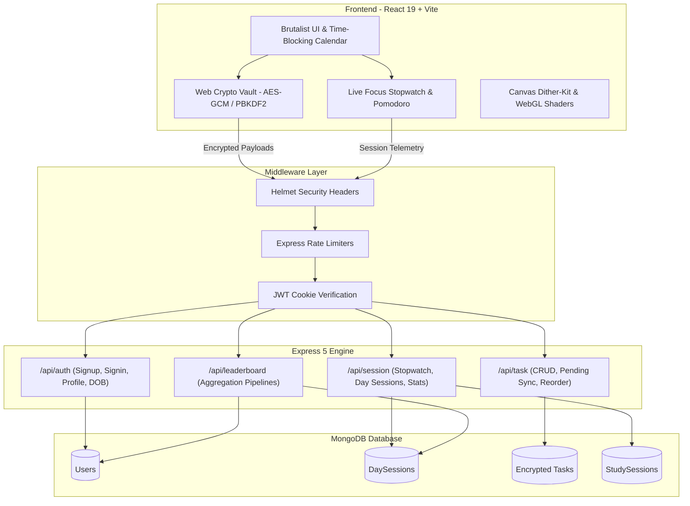

<p align="center">
  
</p>

<h1 align="center">Parkin'son</h1>

<p align="center">
  <strong>High-Performance Deep Work, Time-Blocking, and Life Calendar</strong>
</p>

<p align="center">
  A brutalist, keyboard-first focus workspace engineered for developers, students, and builders.<br />
  Combines interval focus tracking, interactive time-blocking, zero-knowledge encryption, and a 90-year life perspective matrix.
</p>

<p align="center">
  <a href="#overview">Overview</a> &bull;
  <a href="#core-features">Features</a> &bull;
  <a href="#tech-stack">Tech Stack</a> &bull;
  <a href="#architecture">Architecture</a> &bull;
  <a href="#getting-started">Getting Started</a> &bull;
  <a href="#api-reference">API Reference</a> &bull;
  <a href="#license">License</a>
</p>

---

## Overview

Parkin'son is a unified focus operating system designed to eliminate digital clutter and enforce deliberate execution. Instead of juggling separate apps for timers, task managers, and calendars, Parkin'son integrates them into a single, cohesive workflow:

- Plan your day on an interactive time-blocking calendar grid.
- Execute sessions with a precision stopwatch or Pomodoro cycle.
- Link sessions directly to encrypted tasks with automatic completion sync.
- Reflect on your mortality and long-term milestones using the Life in Weeks matrix.
- Track focus consistency through high-density activity heatmaps and community leaderboards.

---

## Core Features

### 1. Focus Stopwatch and Pomodoro Engine
- **Dual Mode Operation**: Seamlessly toggle between a count-up stopwatch and structured Pomodoro countdown intervals.
- **Phase Presets**: Dedicated 25-minute Focus, 5-minute Short Break, and 15-minute Long Break presets with 4-cycle progress tracking.
- **Task Linking**: Connect active timers directly to today's pending tasks via an integrated search combobox.
- **Task Completion Sync**: Choose between completing the associated task upon save or saving session metrics independently.
- **Harmonic Audio Chimes**: Dual-sine audio synthesis via the Web Audio API on session completion without external audio files.
- **Today's Session History**: Real-time log of completed focus intervals with duration badges and timestamps.
- **Quick Stats Bar**: Live calculation of today's total focus hours, completed session count, and current status.

### 2. Interactive Calendar and Time-Blocking System
- **Five Dedicated Views**: Switch between Day, Week, Month, Year, and Life views.
- **Click-to-Schedule**: Click any open interval on Day or Week views to open a cursor-anchored quick-add modal pre-filled with the exact date and time.
- **Snappy Spring Modal**: Compact brutalist popover with Framer Motion spring physics, recessed inputs, duration presets (15m to 2h), and priority selectors.
- **Direct Drag-and-Drop**: Reposition tasks across the grid with real-time snap-to-grid collision handling.
- **Duration Resizing**: Drag task edges vertically to adjust durations with live feedback.
- **Backlog Drawer**: Slide-out tray for unassigned tasks with one-click auto-arrange scheduling.

### 3. Year View Activity Heatmap
- **High-Density Tile Grid**: GitHub-style activity mosaic showing annual study distribution.
- **Monochrome Blue Palette**: Five distinct activity tiers ranging from subtle slate to electric cobalt.
- **Hover Tooltips**: Inspect exact dates, total tasks scheduled, focus time logged, and intensity ratings.
- **User Configurable**: Toggle the heatmap on or off directly from the Settings menu.

### 4. Life in Weeks Matrix (Memento Mori)
- **Zero-Scroll Viewport**: All 4,680 weeks of a 90-year lifespan fit entirely within the calendar screen without vertical scrolling.
- **Visual Tile States**: Differentiates lived weeks, current week beacon, future weeks, and pinned milestones.
- **Era Scope Filter**: Switch between Full 90-Year overview, Current Era (18-year active window), and decade-based slices.
- **Milestone Pinning**: Pin and reflect on milestones categorized by Career, Growth, Education, Health, and Travel.
- **Memento Mori Dashboard**: Real-time metrics tracking weeks lived, weeks remaining, percentage elapsed, and stoic reflections.

### 5. Daily Focus Workspace and Task Management
- **Date Normalization**: Daily task containers normalized to prevent local timezone drift.
- **Optimistic UI Updates**: Zero-latency task creation, status toggles, and removals.
- **End-to-End Encryption (E2EE)**: Client-side cryptographic vault using PBKDF2 key derivation and 256-bit AES-GCM encryption.

### 6. Focus Arena (Community Leaderboard)
- **Podium Rankings**: Highlights top performers with gold, silver, and bronze standing cards.
- **Dual Timeframes**: Compare performance across today's sprint and all-time focus records.
- **MongoDB Aggregation**: Server-side aggregation pipelines compute ranks and XP metrics with minimal database load.

### 7. Analytics and Dither Visualizations
- **Dither Canvas Graphics**: Bespoke charts built with retro pixel dithering algorithms.
- **Deep Metrics**: Visual breakdown of focus hours, completion rates, weekly velocity, and study patterns.

---

## Tech Stack

| Layer | Technologies |
| :--- | :--- |
| **Frontend Framework** | React 19, React Router v7, Vite |
| **Styling & Motion** | Tailwind CSS v4, Framer Motion |
| **Icons & Typography** | Phosphor Icons, Bodoni Moda, Cinzel, Pixeloid |
| **Graphics & Shaders** | Three.js, WebGL GLSL Shaders, HTML5 Canvas Dither Engine |
| **Client Cryptography** | Web Crypto API (AES-GCM 256-bit, PBKDF2 SHA-256) |
| **Backend Runtime** | Node.js, Express 5 |
| **Database & ODM** | MongoDB, Mongoose 8 |
| **Security & Utilities** | Helmet, Express Rate Limit, Bcrypt, JWT, Cookie-Parser, Winston |

---

## Architecture



---

## Getting Started

### Prerequisites
- Node.js (v18.x or v20.x+)
- npm (v9.x or higher)
- MongoDB instance running locally on port 27017 or a MongoDB Atlas URI

### Single-Command Setup (Recommended)

1. Clone the repository:
   ```bash
   git clone https://github.com/mailmeatdarshan/Parkin-son.git
   cd Parkin-son
   ```

2. Install all root, backend, and frontend dependencies:
   ```bash
   npm run install:all
   ```

3. Configure environment variables for the backend:
   Create a `.env` file in the `backend/` directory:
   ```env
   PORT=5000
   MONGODB_URI=mongodb://localhost:27017/parkinson
   JWT_SECRET=your_jwt_secret_key_here
   NODE_ENV=development
   ```

4. Start both backend and frontend concurrently:
   ```bash
   npm run dev
   ```
   - Frontend runs on: `http://localhost:5173`
   - Backend API runs on: `http://localhost:5000`

---

## Available Scripts

| Command | Description |
| :--- | :--- |
| `npm run dev` | Starts backend and frontend development servers concurrently |
| `npm run backend` | Starts the Express backend server with nodemon |
| `npm run frontend` | Starts the Vite frontend server |
| `npm run build` | Compiles and builds production assets for the frontend |
| `npm run install:all` | Installs dependencies across root, backend, and frontend packages |

---

## API Reference

### Authentication (`/api/auth`)
- `POST /api/auth/signup` - Register a new account with name, email, and password.
- `POST /api/auth/signin` - Authenticate user credentials and issue an HttpOnly JWT cookie.
- `GET /api/auth/profile` - Retrieve authenticated user profile, settings, and life milestone metadata.
- `PUT /api/auth/profile` - Update user bio, social links, date of birth, and lifespan preferences.
- `POST /api/auth/logout` - Clear authentication cookies and terminate session.

### Tasks (`/api/task`)
- `POST /api/task/addtask` - Create a new encrypted task linked to a day session.
- `GET /api/task/gettask/:daySessionId` - Retrieve tasks for a specific day.
- `GET /api/task/today-pending` - Retrieve all unfinished tasks scheduled for today.
- `PATCH /api/task/patchtask/:taskId` - Update task title, priority, or completion status.
- `DELETE /api/task/deletetask/:taskId` - Delete a task record.

### Sessions and Stopwatch (`/api/session`)
- `GET /api/session/day/all` - List historical day session records.
- `POST /api/session/day/add` - Create or retrieve today's focus session record.
- `POST /api/session/stopwatch/start` - Record timer start timestamp.
- `POST /api/session/stopwatch/stop` - Commit elapsed focus time, increment counters, and log session.
- `GET /api/session/stopwatch/today-stats` - Retrieve aggregate focus time and session counts for today.

### Leaderboard (`/api/leaderboard`)
- `GET /api/leaderboard` - Fetch ranked user standings sorted by today and all-time focus metrics.

---

## Security Model

Parkin'son enforces zero-knowledge architecture on sensitive user tasks:
- **Client Derivation**: A 256-bit Master Encryption Key is derived in the browser using PBKDF2 with 100,000 SHA-256 iterations and unique user salt.
- **Symmetric Encryption**: Task content is encrypted using AES-GCM with unique initialization vectors (IVs) prior to transmission.
- **Server Agnostic**: The backend database stores only encrypted ciphertext strings and initialization vectors. Even with full database access, task content cannot be decrypted without the user's master key.

---

## License

This project is open-source software licensed under the [ISC License](LICENSE).
